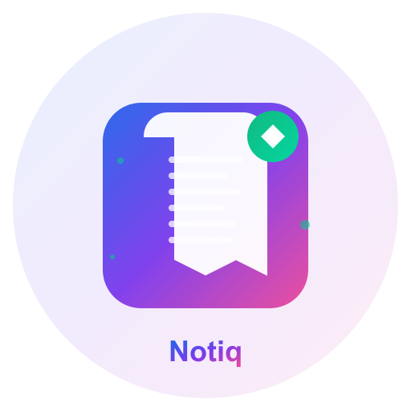
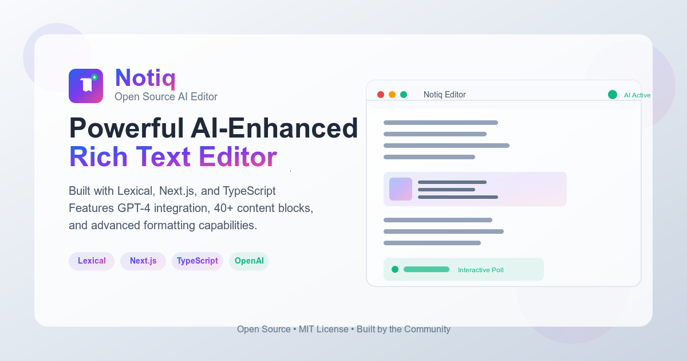
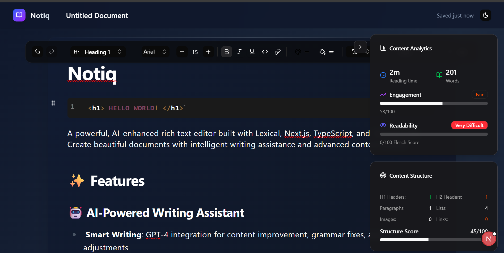
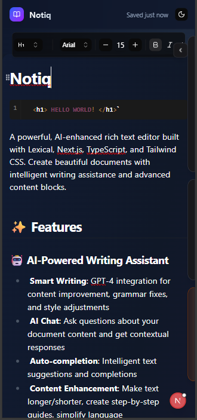

<div align="center">
  
  <h1>Notiq</h1>


[](https://app.codacy.com/gh/chinonsochikelue/notiq/dashboard?utm_source=gh&utm_medium=referral&utm_content=&utm_campaign=Badge_grade)


  <p>
    <strong>The Next-Generation Rich Text & Spatial Content Framework for React and Next.js.</strong><br/>
    <em>Built on Meta's modern Lexical engine, styled with Tailwind CSS, and designed to exceed Tiptap with native AI diffing, Notion-style block drag handles, multi-column snapping, and infinite whiteboard canvas.</em>
  </p>
  <p>
    <a href="https://notiq-editor.vercel.app">Documentation</a> •
    <a href="https://notiq-editor.vercel.app/docs">Live Demo</a> •
    <a href="https://github.com/chinonsochikelue/notiq/issues">Report Bug</a>
  </p>
</div>



## ⚔️ Why Notiq over Tiptap & Other Editors?

| Capability | Notiq | Tiptap | Raw Lexical | Novel / BlockNote |
| :--- | :---: | :---: | :---: | :---: |
| **Underlying Engine** | Modern Lexical (Meta) | ProseMirror (2015) | Lexical (Meta) | ProseMirror |
| **Headless Extension API** | ✅ `editor.chain()...` | ✅ `editor.chain()...` | ❌ Complex boilerplate | ⚠️ Limited |
| **Drop-in Battery-Included UI** | ✅ `<Editor />` | ❌ DIY | ❌ DIY | ⚠️ Rigid Opinionated |
| **Inline AI Command Bar (`⌘K`)** | ✅ Built-in with Live Streaming Diff | ❌ Paid / DIY | ❌ DIY | ⚠️ Basic Streaming |
| **Notion Block Drag Handles** | ✅ Gutter Handle (`⠿`) + Quick Add (`+`) + Turn Into | ⚠️ Extension required | ❌ DIY | ⚠️ Basic |
| **Multi-Column Snapping** | ✅ 2 & 3 Column Layouts Built-in | ⚠️ Complex setup | ❌ DIY | ❌ |
| **Document-to-Canvas Hybrid** | ✅ Infinite Spatial Whiteboard Mode | ❌ | ❌ | ❌ |
| **Subpath Exports** | ✅ `@notiq`, `/core`, `/react`, `/styles.css` | ✅ | ❌ | ⚠️ |
| **Real-time Collaboration** | ✅ Yjs + IndexedDB Offline Persistence | ⚠️ Pro Extension | ⚠️ Complex | ⚠️ |

---

## 📸 Screenshots

<div align="center">
  <h3>Desktop View</h3>
  
</div>

<div align="center">
  <h3>Mobile View</h3>
  
</div>

---

## ✨ Core Highlights

### ⚡ 1. Headless Framework Architecture (Tiptap-Compatible API)
Use Notiq completely headless with an extensible plugin architecture, chained commands, and full control over markup:
```tsx
import { useEditor, EditorContent, StarterKit, AIKit, BubbleMenu } from "@collabchron/notiq";

export default function CustomEditor() {
  const editor = useEditor({
    extensions: [
      StarterKit.configure({ heading: { levels: [1, 2, 3] } }),
      AIKit.configure({ apiEndpoint: "/api/ai" }),
    ],
    content: "<p>Hello world from Notiq!</p>",
  });

  return (
    <div>
      <BubbleMenu editor={editor} showAskAI={true} />
      <EditorContent editor={editor} />
    </div>
  );
}
```

### 🤖 2. Inline AI Command Bar (`Cmd+K` / `Ctrl+K`)
Select text or hover over any block and trigger `⌘K` to open the Cursor/Novel-style AI Command Bar:
- **Streaming Diff Engine**: Live tokenized LCS diff algorithm showing red strikethrough for removals and green highlight for additions.
- **Quick Action Pills**: Fix Grammar, Improve Writing, Make Longer/Shorter, Change Tone, Translate.
- **Resolution Options**: *Replace Selection*, *Insert Below*, *Retry*, or *Discard*.

### ⠿ 3. Notion-Style Block Drag Handles & Multi-Columns
- **Gutter Handle (`⠿`)**: Hover over any block to drag-and-drop reorder.
- **Quick Add (`+`)**: Click the plus icon to instantly spawn an empty paragraph below.
- **Block Action Menu**: Transform any block via *Turn Into* (H1-H3, bullet/numbered lists, quotes, code block), duplicate, delete, or invoke AI directly on that block.
- **Multi-Column Snapping**: Split blocks into responsive 2-column (`1fr 1fr`) or 3-column (`1fr 1fr 1fr`) layouts with `editor.commands.setColumns(2 | 3)`.

### 🎨 4. Document-to-Canvas Hybrid Mode
Switch any document into an infinite spatial whiteboard view with `<CanvasMode />`:
- Smooth Pan & Zoom canvas (40% to 250% zoom).
- Movable, resizable cards: Primary Editor, Color-coded Sticky Notes (Yellow, Blue, Emerald, Purple, Rose), and Excalidraw whiteboards.
- Dot-grid spatial layout with dark/light theme awareness.

---

## 🚀 Installation & Usage

### 1. Installation

```bash
npm install @collabchron/notiq
# or
pnpm add @collabchron/notiq
# or
yarn add @collabchron/notiq
```

### 2. Import Styles

Import the CSS file in your root layout file (e.g. `app/layout.tsx` or `pages/_app.tsx`):

```tsx
import "@collabchron/notiq/styles.css";
```

### 3. Usage Approaches

#### Option A: Batteries-Included Drop-In Component
If you want a full-featured Notion-like editor with toolbars, slash commands, drag handles, and AI out of the box:

```tsx
"use client";

import { Editor } from "@collabchron/notiq";

export default function MyEditorPage() {
  return (
    <Editor 
      isEditable={true}
      aiConfig={{
        apiEndpoint: "/api/ai", // Your AI completion endpoint
      }}
      uploadConfig={{
        uploadHandler: async (file) => {
          return { url: "https://your-storage.com/file.png" };
        }
      }}
    />
  );
}
```

#### Option B: Headless Framework (Tiptap Alternative)
If you want complete control over your UI and state using chained commands:

```tsx
"use client";

import { useEditor, EditorContent, StarterKit, BlocksKit } from "@collabchron/notiq";

export default function HeadlessEditor() {
  const editor = useEditor({
    extensions: [StarterKit, BlocksKit],
    content: "<h1>Headless Lexical Power</h1>",
  });

  if (!editor) return null;

  return (
    <div className="border rounded-lg p-4">
      <div className="flex gap-2 mb-4 border-b pb-2">
        <button 
          onClick={() => editor.chain().focus().toggleBold().run()}
          className={editor.isActive("bold") ? "font-bold text-blue-500" : ""}
        >
          Bold
        </button>
        <button onClick={() => editor.commands.setColumns(2)}>
          2 Columns
        </button>
        <button onClick={() => editor.commands.openAICommandBar()}>
          Ask AI (⌘K)
        </button>
      </div>
      <EditorContent editor={editor} className="prose max-w-none" />
    </div>
  );
}
```

#### Option C: Document-to-Canvas Whiteboard View
Embed the infinite canvas mode:

```tsx
"use client";

import { useState } from "react";
import { Editor, CanvasMode } from "@collabchron/notiq";

export default function HybridPage() {
  const [isCanvas, setIsCanvas] = useState(false);

  return (
    <div>
      <button onClick={() => setIsCanvas(!isCanvas)}>
        {isCanvas ? "Switch to Document View" : "Switch to Spatial Canvas View"}
      </button>

      {isCanvas ? (
        <CanvasMode onExit={() => setIsCanvas(false)} />
      ) : (
        <Editor isEditable={true} />
      )}
    </div>
  );
}
```

---

## 📦 Package Subpath Exports

Notiq provides tree-shakeable modern ES and CommonJS subpath exports:

- `@collabchron/notiq` &mdash; Drop-in `<Editor />`, `<CanvasMode />`, UI components, and all framework exports.
- `@collabchron/notiq/core` &mdash; Headless engine: `Editor`, `Extension`, `NodeExtension`, `MarkExtension`, `CommandChain`, and extensions (`StarterKit`, `AIKit`, `CollaborationKit`, `BlocksKit`).
- `@collabchron/notiq/react` &mdash; React hooks and components: `useEditor`, `EditorContent`, `BubbleMenu`, `FloatingMenu`.
- `@collabchron/notiq/styles.css` &mdash; Production CSS bundle containing all editor theme tokens, dot grid utilities, and KaTeX fonts.

---

## 🛠️ Local Development

### Installation

```bash
git clone https://github.com/chinonsochikelue/notiq.git
cd notiq
pnpm install
```

### Environment Setup

Create `.env.local`:

```env
OPENAI_API_KEY=your_openai_api_key_here
NEXT_PUBLIC_EDGESTORE_ACCESS_KEY=your_edgestore_key
NEXT_PUBLIC_EDGESTORE_SECRET_KEY=your_edgestore_secret
```

### Development Server

```bash
npm run dev
# or
pnpm dev
```

Visit [http://localhost:3000](http://localhost:3000) for the main editor and [http://localhost:3000/framework](http://localhost:3000/framework) for the interactive framework playground.

### Running Tests

```bash
npm run test
# or
npx vitest run
```

### Building the Package

```bash
npm run build:lib
```

---

## 🤝 Contributing

We welcome contributions! Please see our [Contributing Guidelines](CONTRIBUTING.md) for details on how to get started, submitting bug reports, and suggesting enhancements.

---

## 📄 License

MIT License - see the [LICENSE](LICENSE) file for details.

---

Built with ❤️ by [Chinonso Chikelue (fluantiX)](https://github.com/chinonsochikelue) and the CollabChron community.
